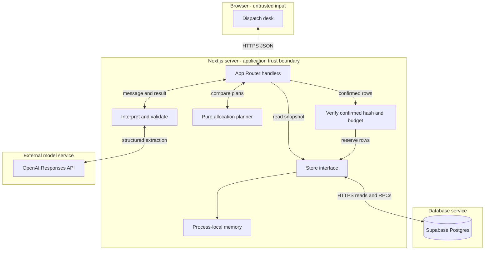
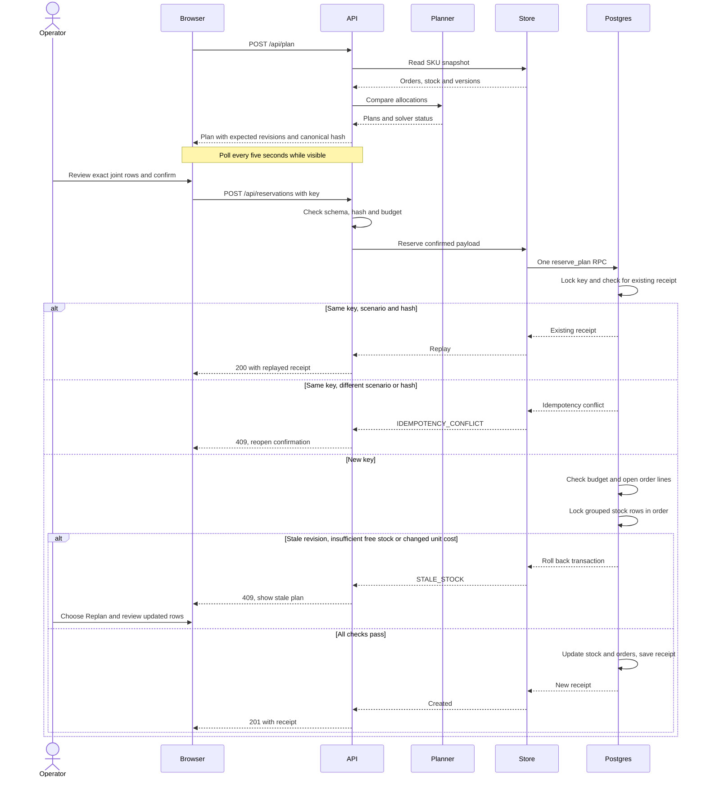

# OrderRescue architecture

The desk sends a warehouse message or an operator-entered incident to a Next.js route handler. The server owns validation, allocation and writes. Selecting a scenario also sets the clock used for planning. Quantities are whole units, costs are integer baht and timestamps carry Bangkok's UTC+07:00 offset.

## Request flow and trust boundaries

The model sees the submitted text and instructions with the scenario date, warehouse names and shifts. The state route sends public order and stock data to the desk and omits customer references. Service credentials stay on the server. Every interpreted response passes through the same validator, including an offline sample. Manual entry supplies a warehouse, one SKU and a time window directly to the planning route. Only the reservation handler accepts a booking.

Postgres tables have row-level security enabled and no public policies. The server's service role can call the booking, event and reset functions. Browser roles have their table and function privileges revoked. [Database migration](../supabase/migrations/20261121044705_init.sql)

First-come processes orders in arrival order and takes the cheapest feasible on-time source. The joint search ranks whole-line assignments by on-time count, then earlier deadlines, lower total cost, earlier arrivals and finally stable order/warehouse IDs. It starts with a feasible incumbent and returns either a proven optimum or the best plan found by the 200,000-node limit. [First-come](../lib/planner/firstCome.ts) · [Objective](../lib/planner/objective.ts) · [Joint search](../lib/planner/joint.ts)

## Booking protocol

The hash covers the scenario, incident, budget and six fields per confirmed line in stable order. The fields are order, SKU, warehouse, quantity, unit cost and expected stock revision. The dialog creates a UUID when it opens and reuses that UUID after an uncertain response. A hash mismatch or excessive cost is rejected before the Store call. Each booked order must have a matching open line and exact quantity. Two lines drawing from the same stock row consume their combined quantity and advance its revision once. Any refusal rolls back the reservation. The memory adapter implements the same rules in one synchronous critical section. [Booking service](../lib/api/planning.ts) · [Hash](../lib/planner/hash.ts) · [SQL transaction](../supabase/migrations/20261121044705_init.sql)

## Module responsibilities

| Module | Responsibility |
| --- | --- |
| [Desk](../app/page.tsx), [client state](../lib/client/use-desk.ts) | Display interpretation and plans, submit confirmed rows, poll revisions, recover a receipt after a lost response. |
| [Route handlers](../app/api), [HTTP boundary](../lib/http.ts) | Parse requests, select the service, map typed errors to HTTP statuses and attach a request ID. |
| [Domain](../lib/domain) | Define schemas, timestamps, quantities and money shared across the wire. |
| [Interpreter](../lib/interpreter) | Call the primary and fallback readers, match offline samples and validate each answer against the message and scenario. |
| [Planner](../lib/planner) | Identify open orders at the affected home warehouse, compute feasible sources and compare allocations under a shared budget. |
| [Store](../lib/store), [SQL migrations](../supabase/migrations) | Implement snapshot reads, atomic reservation, demo events and reset. A failed database read can serve a memory snapshot and close the database write path until recovery. |
| [Scenarios](../lib/scenarios), [derived data](../data/derived), [provenance](../lib/provenance.ts) | Supply the synthetic hero and seeded real-day snapshot and disclose each field's origin. |
