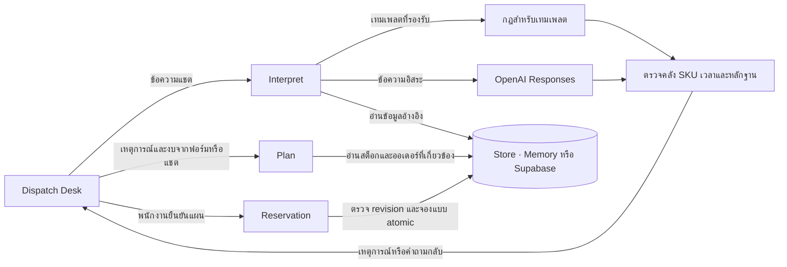

# OrderRescue Architecture Review Recommendations

**ข้อเสนอสำหรับรีวิวโดยทีมพัฒนา · 21 พฤศจิกายน 2569 · วิเคราะห์ที่ `62e6e41` และเทียบกับ `origin/main` ที่ `72a97f2`**

ผู้ใช้คือพนักงานจัดส่งที่รับแจ้งเหตุจากคลังและต้องตัดสินใจว่าจะจัดออเดอร์ใหม่อย่างไร เราเสนอให้ **แยกข้อมูลที่ต้องอ่านสำหรับ Interpret และ Plan ที่ชั้น Store** และ **ให้ข้อความในเทมเพลตที่ตกลงกันใช้กฎก่อนเรียก OpenAI** เป้าหมายคือส่งข้อมูลเท่าที่จำเป็นและลดจำนวนการเรียกโมเดล โดยผลวางแผน การตรวจแผนเก่า และความถูกต้องของใบจองต้องเท่าเดิม

สำหรับ agent ผู้รับช่วง ให้ fetch repo แข่งใหม่ ตรวจ branch และ working tree แล้วอ่าน `AGENTS.md`, `docs/SPEC.md` เฉพาะส่วน 5–8 และเกณฑ์รับงานที่เกี่ยวข้อง เทียบไฟล์กับ commit ล่าสุดก่อนหยิบงาน เอกสารนี้ใช้ขอรีวิวและอนุมัติขอบเขต ให้ทีมเลือกงานก่อนเริ่ม implementation [Repo และข้อกำหนด](https://github.com/NamiNaone99/orderrescue/blob/62e6e41957cc9f3f89486f73f5faca4828f67f90/AGENTS.md) · [Product specification](https://github.com/NamiNaone99/orderrescue/blob/62e6e41957cc9f3f89486f73f5faca4828f67f90/docs/SPEC.md) · [Test plan](https://github.com/NamiNaone99/orderrescue/blob/62e6e41957cc9f3f89486f73f5faca4828f67f90/docs/TEST_PLAN.md)

## 1. ภาพรวมและฐานที่ตรวจแล้ว

สถาปัตยกรรมเป้าหมายเป็น Next.js แอปเดียว ยืมจาก YIBDEE ตรงการให้ตัวตีความส่งผลแบบมีโครงสร้างไปยังโค้ดที่ตรวจข้อมูลและทำงานต่อ OrderRescue ใช้ LLM จุดเดียวใน Interpret โมเดลหลักและสำรองเรียกผ่าน OpenAI Responses API เดียวกัน การอ่านฐานข้อมูล การจัดสต็อก การคำนวณใหม่ และการจองเป็นงานของ backend



| จุดในระบบ | พฤติกรรม ณ commit ที่ตรวจ |
| --- | --- |
| `POST /api/interpret` | รับข้อความสูงสุด 500 ตัวอักษร อ่าน `getSnapshot(scenario)` โค้ดส่งให้ OpenAI เฉพาะข้อความ คำสั่งและ schema พร้อมวันอ้างอิง ชื่อคลัง และกะ ตัว validator ใช้รายการ SKU ฝั่ง backend |
| `POST /api/plan` | เรียก `getSnapshot(scenario, { sku })` แต่ Supabase ดึง stock, orders, order lines, catalog และ reservations ทั้ง scenario จาก view แล้วค่อยกรองใน TypeScript |
| `GET /api/state` | รองรับ `sku` และยังใช้ view เดิม Desk เรียกอ่านหลังวางแผน และ poll ทุก 5 วินาทีขณะเห็นแผน การอ่านนี้เป็น DB traffic |
| โหมดการตีความ | `offline` รู้จักข้อความตัวอย่างตาม AC-24 ใน live mode โมเดลหลักปกติ 1 call และ fallback ได้สูงสุด 2 attempts ต่อคำขอ ตัดสินตาม quota ปัจจุบัน |
| ขนาดข้อมูลตัวอย่าง | `real-day` มี 129 ออเดอร์ 2,674 รายการย่อย 1,190 SKU และ 3,570 แถวสต็อก ใน fixture มี 25 รายการย่อยของ SKU `23084` ก่อนกรองคลังและสถานะ และสต็อก 3 แถวของ SKU นี้ ออเดอร์อิง UCI และข้อมูลคลัง/สต็อก/เวลา/ต้นทุนที่ใช้วางแผนเป็นข้อมูลจำลอง |

[Interpret route](https://github.com/NamiNaone99/orderrescue/blob/62e6e41957cc9f3f89486f73f5faca4828f67f90/app/api/interpret/route.ts) · [Model adapter](https://github.com/NamiNaone99/orderrescue/blob/62e6e41957cc9f3f89486f73f5faca4828f67f90/lib/interpreter/openai.ts) · [Supabase read](https://github.com/NamiNaone99/orderrescue/blob/62e6e41957cc9f3f89486f73f5faca4828f67f90/lib/store/supabase.ts#L68-L80) · [Plan service](https://github.com/NamiNaone99/orderrescue/blob/62e6e41957cc9f3f89486f73f5faca4828f67f90/lib/api/planning.ts) · [Desk polling](https://github.com/NamiNaone99/orderrescue/blob/62e6e41957cc9f3f89486f73f5faca4828f67f90/lib/client/use-desk.ts#L104-L132) · [Data provenance](https://github.com/NamiNaone99/orderrescue/blob/62e6e41957cc9f3f89486f73f5faca4828f67f90/data/ATTRIBUTION.md)

## 2. สัญญาที่งานนี้ต้องรักษา

- `Store` เป็นจุดอ่าน/เขียนข้อมูลของทั้ง Memory และ Supabase ให้ backend ตรวจ schema และ scope ของ scenario เสมอ
- `lib/planner` ยังเป็น pure function รับ snapshot + incident + budget ใช้กติกาเดิมและคืนผลเดิมเมื่อข้อมูลเท่ากัน
- ผู้ใช้ยืนยันแถวที่จะจองก่อน `POST /api/reservations` ตรวจ stock revision, ยอดจองเดิม, จำนวน, ต้นทุน และ idempotency เหมือนเดิม การจองหนึ่งชุดสำเร็จทั้งหมดหรือไม่มีแถวเปลี่ยน
- `state_version` ยังเป็น digest ของ **revision ของสต็อกและสถานะออเดอร์ทั้ง scenario** ตาม `stateVersion()` ส่วน Desk ตัดสินว่าแผนเก่าจากแถวสต็อกและออเดอร์ที่เกี่ยวข้องกับแผน การเปลี่ยน version ของ SKU อื่นจึงไม่ควรสร้าง stale banner ให้แผนนี้โดยลำพัง
- รักษา request/response และ booking hash เดิม งาน fast path มีข้อเสนอให้เพิ่มค่า `rules` ใน enum ที่ระบุแหล่งตีความ ต้องรีวิว contract ฝั่ง client ก่อนเปิดใช้งาน
- ผู้ให้บริการโมเดลเห็นแค่ข้อความและบริบทสำหรับตีความ ข้อมูลลูกค้า ประวัติการจอง และข้อมูลสต็อกอยู่ฝั่ง backend จำนวน provider attempts สูงสุด 2 ต่อหนึ่งคำขอ Interpret ส่วน Plan, State และ Reservation ใช้ 0
- โหมด Supabase ที่ใช้ข้อมูล memory ระหว่างขัดข้องยังต้องปฏิเสธการเขียน การอ่าน metadata สำเร็จเพียงอย่างเดียวใช้ปลดสถานะขัดข้องของการจองไม่ได้ ต้องอ่านข้อมูลปฏิบัติการจากฐานข้อมูลจริงสำเร็จตาม contract ของ Store

[Store interface และวิธีสร้าง version](https://github.com/NamiNaone99/orderrescue/blob/62e6e41957cc9f3f89486f73f5faca4828f67f90/lib/store/types.ts) · [Store fallback](https://github.com/NamiNaone99/orderrescue/blob/62e6e41957cc9f3f89486f73f5faca4828f67f90/lib/store/index.ts) · [เงื่อนไข stale บน Desk](https://github.com/NamiNaone99/orderrescue/blob/62e6e41957cc9f3f89486f73f5faca4828f67f90/lib/client/plan-changes.ts) · [Booking protocol](https://github.com/NamiNaone99/orderrescue/blob/62e6e41957cc9f3f89486f73f5faca4828f67f90/docs/SPEC.md#8-staleness-and-booking-protocol)

## 3. ลำดับงานที่เสนอ

### งาน 1 · แยกข้อมูลอ้างอิงของ Interpret

**ผลที่ต้องได้** `/api/interpret` ขอเฉพาะข้อมูลตีความผ่าน Store เริ่มด้วย read เดียวต่อ scenario ที่คืน `id`, `now_at`, `shifts`, คลังแบบ `id/name_th` และ SKU แบบ `id/name` ให้ validator ใช้ dictionary นี้ใน backend ข้อมูล SKU ทั้งชุดไม่เข้า prompt และ read นี้ไม่มี order, stock หรือ receipt หาก catalog โตจน query นี้ยังหนัก ค่อยแยก lookup SKU ตาม ID ที่พบ โดยคงการใช้งาน validator และแยกความล้มเหลวของ DB ออกจากเงื่อนไข retry โมเดล

**แนวทำ** เพิ่ม `getInterpretContext(scenarioId)` ใน Store ใช้ SQL projection จากตารางฐานใน Supabase โดยเลือกเฉพาะคอลัมน์ที่ต้องใช้ และคืน timestamp รูปแบบ Bangkok ตาม contract เดิม Memory adapter คืน projection เดียวกัน ปรับ `buildSystemPrompt()`, `validate()` และ offline interpreter ให้รับ context ที่แต่ละส่วนต้องใช้แทน `Snapshot` เต็ม หากตีความจาก metadata ของ memory ตอน Supabase ขัดข้องให้รักษา guard การเขียนของ Store ใช้ migration ใหม่สำหรับ view หรือ read RPC ตามรูปแบบ repo และจำกัดสิทธิ์ไว้ฝั่ง server

| ไฟล์หรือกลุ่มไฟล์ | สิ่งที่ต้องแตะ |
| --- | --- |
| `lib/store/types.ts`, `lib/store/memory.ts`, `lib/store/supabase.ts`, `lib/store/index.ts` | Context ที่แคบลง, adapter ทั้งสอง และการจัดการ degraded mode |
| `app/api/interpret/route.ts`, `lib/interpreter/chain.ts`, `lib/interpreter/prompt.ts`, `lib/interpreter/validate.ts`, `lib/interpreter/offline.ts` | ต่อ read ใหม่ และรักษา validation, evidence, quota และ fallback เดิม |
| `lib/interpreter/index.ts`, `scripts/eval.ts`, `scripts/try-interpret.ts` | ทบทวน exports และ caller ตาม typecheck คงการรัน offline/eval ที่มีอยู่ |
| `supabase/migrations/<timestamp>_interpret_context.sql` · เสนอไฟล์ใหม่ | Read projection แบบ server-only ใช้ migration เพิ่มจากของเดิม |
| `tests/api/interpret.test.ts`, `tests/interpreter/`, `tests/store/supabase-adapter.test.ts`, `tests/store/memory-integration.test.ts` | Route contract, parity ของ adapter และ coverage สำหรับ projection |

**เกณฑ์รับงาน**

- [ ] Interpret ใช้ read ใหม่ และทดสอบด้วย spy/fake transport ว่า route ไม่เรียก view snapshot เต็มหรือดึง stock, order lines และ reservations
- [ ] ข้อความ hero, clarification, ignore, unknown SKU, unknown warehouse, exact evidence และคำสั่งให้จองผ่าน regression เดิม รวมถึง 501 ตัวอักษรให้ 422 ก่อนอ่าน DB หรือเรียก AI
- [ ] Fake provider ตรวจว่า request ไม่มี catalog SKU, stock, order หรือ customer ref โมเดลสำรองยังทำงานตามกติกาเดิม
- [ ] Supabase unavailable ใช้ policy fallback เดิม Unknown scenario ยังคง error เดิม และ metadata read ที่สำเร็จไม่ทำให้ booking หลัง degraded read ผ่านโดยข้าม operational refresh

### งาน 2 · ให้ Plan กรองข้อมูลตั้งแต่ฐานข้อมูล

**ผลที่ต้องได้** สำหรับ incident หนึ่ง ให้ backend อ่านเฉพาะ scenario และคลังที่ต้องตรวจ SKU ที่เลือก ออเดอร์ `open` ของคลังที่เกิดเหตุที่มี line ของ SKU นั้น และสต็อกของ SKU นั้นจาก **ทุกคลังที่เป็นทางเลือก รวมถึงคลังต้นทาง** Planner ยังเป็นผู้ประเมินผลของช่วงงดหยิบ เวลาที่สต็อกพร้อม งบ เหตุผลที่จัดไม่ได้ และการจัดหลังจบช่วงเหตุ

**แนวทำ** เพิ่ม `getPlanningSnapshot(scenarioId, { warehouseId, skuId })` ใช้ parameterized read RPC หรือ SQL read เดียวเพื่อให้ projection และ version inputs มาจาก snapshot เดียวกัน ใช้ข้อมูล version แบบย่อจากทั้ง scenario ได้แก่ `warehouse_id/sku_id/revision` ของสต็อกและ `id/status` ของออเดอร์ แล้วใช้ `stateVersion()` เดิม ห้าม hash เฉพาะแถวที่กรองมา หากต้องย้าย hash ไป SQL ให้ถือเป็นแยกงานและพิสูจน์ canonical bytes ก่อน ทิ้งฟิลด์ที่ planner ไม่ใช้ เช่น `customer_ref` และใบจอง ใช้ type projection แคบให้ตรงข้อมูลที่โหลด ทดสอบ index ด้วย execution plan บนข้อมูลตัวอย่างก่อนเพิ่ม migration สำหรับ index

| ไฟล์หรือกลุ่มไฟล์ | สิ่งที่ต้องแตะ |
| --- | --- |
| `lib/store/types.ts`, `lib/store/memory.ts`, `lib/store/supabase.ts`, `lib/store/index.ts` | Planning projection, version inputs และ parity ระหว่าง adapters |
| `lib/api/planning.ts`, `lib/domain/types.ts` | ต่อ read ใหม่ ตรวจ unknown scenario/warehouse/SKU และขีดจำกัด 60 ออเดอร์ตามเดิม |
| `lib/planner/index.ts`, `lib/planner/affected.ts`, `lib/planner/candidates.ts` | แตะเฉพาะ type/shape ที่จำเป็น คงกฎ ตัวเรียงลำดับ และ reason codes |
| `supabase/migrations/<timestamp>_planning_snapshot.sql` · เสนอไฟล์ใหม่ | SQL projection แบบกรองในฐานข้อมูลและจำกัดสิทธิ์ฝั่ง server |
| `tests/api/planning.test.ts`, `tests/api/state.test.ts`, `tests/planner/`, `tests/store/`, `tests/client/plan-changes.test.ts`, `e2e/hero.spec.ts`, `e2e/stale.spec.ts` | เปรียบเทียบ read เดิมกับแบบใหม่ และรัน regression เส้นทางจอง |

**เกณฑ์รับงาน**

- [ ] ผลจาก read เดิมและแบบใหม่บน snapshot เดียวกันให้ affected orders, แถวที่จัดได้, reason codes, ต้นทุน และ `plan_hash` เท่ากัน รวม hero และ SKU `23084` ใน real-day
- [ ] Hero ก่อนเลื่อน B ได้ first-come 1/2 ที่ 32 บาท และ joint 2/2 ที่ 88 บาท หลัง B เลื่อนได้ joint 1/2 ที่ 32 บาท รันงบ 88/87/31, หลังช่วงเหตุ, tie-break, commitment และ no-split ด้วย
- [ ] SQL ส่งเฉพาะข้อมูลที่ใช้วางแผน ตรงขีดจำกัด 60/61 ออเดอร์ และแยก SKU ที่มีอยู่แต่ไม่มีออเดอร์ออกจาก SKU ที่ไม่รู้จัก Plan และ State คืน version เดียวกันเมื่ออ่าน snapshot เดียวกัน
- [ ] การเปลี่ยนสต็อกหรือสถานะออเดอร์จากแผนทำให้ Confirm ถูกปิดตามเดิม การเปลี่ยน SKU ที่ไม่เกี่ยวไม่ทำให้ Desk แจ้ง stale โดยลำพัง จองแผนเก่าได้ 409 `STALE_STOCK` และไม่มีสต็อกเปลี่ยน ยืนยันซ้ำคืนใบจองเดิม
- [ ] เมื่อ Supabase ล่มยังอ่าน memory ได้ตาม policy การจองผ่านได้ต่อเมื่อ operational read จากฐานข้อมูลจริงกลับมาสำเร็จ เปรียบเทียบจำนวนแถว/ขนาดผลลัพธ์ก่อนและหลังบน real-day และบันทึก latency แยก

**จุดที่ควรวัดถัดไป** `GET /api/state?sku=…` ยังอ่าน snapshot ใหญ่จาก view เดิมแม้ query ของ Plan ถูกแยก งานนี้เก็บ baseline ขนาดและความถี่ได้เลย ถ้า polling เป็นภาระหลัก ค่อยทำ read แคบของ State เป็นงานแยกพร้อมเทสต์ stale โดยรักษาความหมายของ version และ receipt summary เดิม

### งาน 3 · เพิ่ม rule-based fast path สำหรับเทมเพลตที่แน่นอน

**ข้อเสนอรุ่นแรก** รองรับเทมเพลตเดียวแบบทั้งข้อความ เช่น `แจ้งงดหยิบ | คลัง=A | SKU=SKU-X | เวลา=13:00-18:00` ใช้ canonical ID หนึ่ง SKU และเวลา HH:MM ภายในวันของ scenario ใช้ตัว parser แบบ anchored ที่ตรวจทุกช่องและตรวจว่าซ้ำหรือขัดกันไหม แล้วส่งผลเข้า validator เดิม ข้อความแชตอิสระ เช่น hero “คลัง A งดหยิบ SKU-X รอบบ่ายวันนี้” ยังเข้าเส้นทางเดิมเพื่อแสดง live model ได้ตามจริง

| อินพุต | ผลที่เสนอ | OpenAI calls |
| --- | --- | --- |
| ฟอร์มที่กรอกครบ | ส่ง incident ที่ตรวจแล้วเข้า Plan ตามทาง manual ของ T10b | 0 |
| เทมเพลตครบและ ID/เวลาผ่าน validation | คืน incident พร้อม evidence จากต้นฉบับและแหล่ง `rules` ก่อนสร้าง client หรือแตะ quota | 0 |
| มีหัวเทมเพลตชัด แต่ช่องขาด ซ้ำ เวลาไม่ถูก หรือมีข้อความแทรก | คืน clarification จากกฎหรือ validator และรอให้ผู้ใช้แก้ | 0 |
| ข้อความอิสระที่ไม่ตรงเทมเพลต ใน live mode | ใช้ LLM และ fallback เดิมตาม quota ส่ง follow-up นับเป็นคำขอใหม่ | ปกติ 1 สูงสุด 2 |
| Offline/no-key | คง exact sample behavior ของ AC-24 และทางกรอกมือ | 0 |

เริ่มเปิด fast path ของข้อความเทมเพลตเฉพาะ live-enabled path หลังทีมอนุมัติ คง `offlineInterpret` เป็นตัวอ่าน exact samples ตาม AC-24 หากทีมต้องการให้เทมเพลตใหม่ใช้ในโหมด offline ด้วย ให้รีวิวความหมายของ AC-24 และแหล่งผลที่จะแสดงก่อนเสนอ contract ใหม่ ฟอร์มยังส่งเข้า Plan โดยตรงได้ตาม T10b

| ไฟล์หรือกลุ่มไฟล์ | สิ่งที่ต้องแตะ |
| --- | --- |
| `lib/interpreter/fast-path.ts` · เสนอไฟล์ใหม่ | Pure parser สำหรับเทมเพลตเดียว ผลแยกเป็นตรงเทมเพลต / เทมเพลตที่ต้องแก้ / ข้อความอิสระ |
| `app/api/interpret/route.ts`, `lib/interpreter/chain.ts`, `lib/interpreter/runtime.ts`, `lib/interpreter/validate.ts` | วางทางลัดก่อน provider/quota ใช้ validator เดิม และคง fallback เดิม |
| `lib/domain/contracts.ts`, `components/desk/message.tsx`, `scripts/eval-score.ts`, `docs/SPEC.md` | หากอนุมัติ enum `rules` ให้ server/client/eval อ่านค่าได้พร้อมกัน และแสดง mode จริง ตรวจความเข้ากันได้ของ client เก่าก่อนเปิด |
| `tests/interpreter/fast-path.test.ts` · เสนอไฟล์ใหม่ และ `tests/api/interpret.test.ts`, `tests/domain/contracts.test.ts`, `tests/interpreter/chain.test.ts`, `tests/interpreter/injection.test.ts` | Unit, contract และการนับ call ด้วย fake provider |
| `lib/client/use-desk.ts` และ UI ฟอร์มจาก T10b · ตรวจ branch ก่อนแตะ | ต่อ manual flow เมื่อจำเป็น โดย reuse UI ของงานที่ทีมมีอยู่ |

**เกณฑ์รับงาน**

- [ ] เทมเพลตที่ถูกต้องให้ incident แบบเดียวกับการกรอกฟอร์ม รวม timezone +07:00 และ quote เป็น substring ของข้อความต้นฉบับ พิสูจน์ provider call = 0 และ quota consumption = 0 แม้รันใน live mode
- [ ] unknown SKU/warehouse, เวลาเท่ากันหรือกลับช่วง, ค่า/ช่องไม่ครบ, field ซ้ำ ข้อความแทรก และคำขอจองต่อท้าย template ได้ clarification และไม่เกิด plan เงียบ ๆ
- [ ] แชตอิสระและคำถามกำกวมเดินเส้นทางเดิม Fake provider ยืนยัน success = 1 call, fallback ≤ 2, no-key/offline = 0 และ quota ที่เต็มใช้ fallback แบบเดิม
- [ ] หน้าจอและ eval แยกผลจากกฎ / OpenAI / offline ได้เมื่อทีมอนุมัติ enum ใหม่ ข้อความ hero อิสระยังแสดงว่ามาจาก live model ในการทดสอบที่เรียก provider จริง
- [ ] ผู้ใช้ที่ยืนยันแผนจาก incident ของกฎได้แผนเดียวกับ incident จากฟอร์ม และยังผ่าน stale/refusal/retry เกณฑ์เดิม

### งาน 4 · วัดผลก่อนขยายขอบเขต

เพิ่ม telemetry หลังจุดเชื่อมงานชัด โดยใช้ `response.usage` เก็บ input/output (reasoning อยู่ใน output), cached input ถ้ามี, จำนวน attempts, source, latency และเหตุผล fallback ต่อโมเดล เก็บ latency/ขนาด response ของ Store ต่อเส้นทางแยกจากค่า AI กรณี provider ไม่คืน usage ให้รายงานว่าไม่ทราบ แยกจาก 0 calls ของกฎ เก็บตัวนับและรหัสสถานะโดยไม่เพิ่มข้อความแชตหรือข้อมูลลูกค้าใน log

**ไฟล์ตามขอบเขตที่เลือก** `lib/interpreter/openai.ts`, `lib/interpreter/chain.ts`, `lib/http.ts` หากต้องผูกกับ request log, `lib/store/supabase.ts` สำหรับ read metrics และ `tests/interpreter/openai.test.ts`, `tests/api/interpret.test.ts` สำหรับ schema/ความเป็นส่วนตัว ใช้ `scripts/eval.ts`, `scripts/eval-score.ts` และ held-out cases ที่ทีมอนุมัติเมื่อจะวัดความแม่นยำ

**เกณฑ์รับงาน** วัดทั้งจำนวน call และสัดส่วนที่ใช้ fallback แยกเส้นทาง รายงานจำนวนตัวอย่างและ latency ของ DB กับโมเดลแยกกัน เทียบฟอร์ม/กฎ/LLM บน input ชุดเดียวกันด้วยเวลาไปถึง incident ที่ถูกต้อง จำนวนการแก้ และ false incidents ให้ชุด held-out ตามเกณฑ์ AC-26 เดิม ผลเทมเพลตผ่านเทสต์หรือ offline sample run อย่างเดียวใช้ยืนยันความแม่นของ live interpreter ไม่ได้ [T12 eval baseline](https://github.com/NamiNaone99/orderrescue/blob/62e6e41957cc9f3f89486f73f5faca4828f67f90/docs/codex-log/T12.md) · [OpenAI token usage](https://developers.openai.com/api/docs/guides/reasoning#managing-the-context-window)

## 4. คิวรีวิวและเกณฑ์รวมก่อน merge

1. **เริ่มงาน 1** เพราะลด read ของ Interpret ได้โดยคงเส้นทางผู้ใช้เดิม เก็บ baseline DB/AI ไปพร้อมกัน
2. **ทำงาน 2 ต่อบน Store interface รุ่นเดียวกัน** ให้คนดู planner ช่วยรีวิว version และผลเปรียบเทียบ ผู้รับงาน 1 และ 2 แตะไฟล์ Store ร่วมกัน จึงควรลงลำดับ merge ให้ชัด
3. **งาน 3 เขียนข้อทดสอบและรีวิวเทมเพลตได้ระหว่างงาน 2** ให้ merge หลัง context/validator ตกลงแล้ว และประสานเจ้าของ T10b ก่อนแตะ UI
4. **ปิดด้วยงาน 4 และ browser smoke** ผู้รีวิว Codex แบบ read-only แยกได้สองด้าน ได้แก่ data scope/staleness และ case ที่ rule parser ยอมรับผิด ให้ lead ตัดสินจาก diff กับผลเทสต์ที่ตรวจได้

คำสั่งที่ทีมควรรันใน PR ที่นำไปทำจริง

```bash
pnpm lint
pnpm typecheck
pnpm test
pnpm test:tz
pnpm e2e e2e/hero.spec.ts e2e/stale.spec.ts e2e/clarify.spec.ts e2e/idempotent.spec.ts
```

รัน `pnpm test:db` แยกเมื่อทีมอนุมัติ hosted environment สำหรับทดสอบ และตรวจว่าใช้ scenario ทดสอบตาม runbook สำหรับผลก่อน merge ให้บันทึก base commit, โหมด storage/interpreter, เคสที่รัน, ผลจริง และสิ่งที่ยังไม่ได้ยืนยัน

**ขอบเขตให้ทีมตัดสินใจ** รอบนี้เสนอการอ่านข้อมูลแคบลงและ fast path เทมเพลตเท่านั้น เมื่อเส้นทางหลักผ่านแล้ว ค่อยพิจารณา what-if แบบอ่านอย่างเดียว ใช้สำเนา snapshot กับ planner เดิม คืนผลก่อน/หลัง และคง Store state เดิม ฟอร์ม what-if ใช้ 0 calls ถ้าเพิ่มคำถามภาษาคนให้ใช้ interpreter จุดเดิมและเพดาน 2 attempts งาน agent หลายตัว, vector search, การตีความหลายข้อความ และการยืนยันแผนจากธุรกรรม production เป็นการตัดสินใจแยกจากแผนนี้

**สถานะเอกสาร** พร้อมให้ทีมรีวิวข้อเสนอ ยังไม่มี implementation หรือผลเทสต์ของข้อเสนอใหม่นี้
